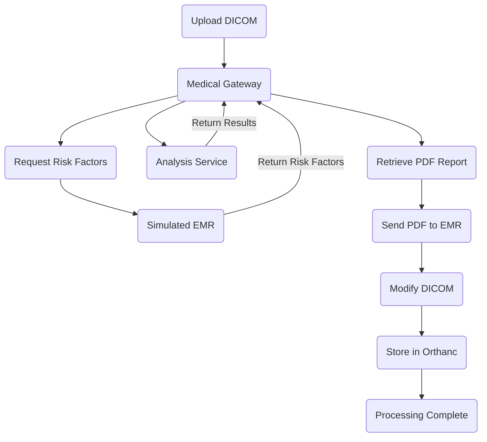

# Medical Integration Gateway

A Dockerised Python application demonstrating medical imaging integration between a DICOM server (Orthanc), a simulated Electronic Medical Record (EMR), and a medical analysis service.

The project demonstrates how independent healthcare systems exchange imaging data, patient risk factors, and PDF reports using REST APIs and DICOM.

## System Architecture

The application consists of four services:

- **Medical Gateway:** Central API coordinating communication between the imaging system, EMR, and analysis service.
- **EMR Service:** Simulated hospital EMR providing patient risk factors and receiving PDF reports.
- **Analysis Service:** Simulated medical analysis application generating predefined analysis results and PDF reports.
- **Orthanc:** Open source DICOM server for storing and inspecting imaging studies.
  


The gateway coordinates communication between services, tracks case processing status, and logs integration failures.

## Tech Stack

| Technology | Purpose |
|---|---|
| Python, FastAPI | Backend development and REST APIs |
| Pydicom | DICOM processing and metadata modification |
| Orthanc | DICOM storage and PACS simulation |
| Docker Compose | Containerisation and service orchestration |
| Requests | HTTP communication between services |
| ReportLab | PDF report generation |
| Pytest | Automated API testing |

## How to Run

**Prerequisite:** Docker Desktop installed and running.

Clone the repository:

```bash
git clone https://github.com/namitagarwal1209/medical-integration-gateway.git
cd medical-integration-gateway
```

Start all four services:

```bash
docker compose up --build -d
```

Access the applications:

| Application | URL |
|---|---|
| Medical Gateway API | http://localhost:8000/docs |
| Simulated EMR API | http://localhost:8001/docs |
| Analysis Service API | http://localhost:8002/docs |
| Orthanc PACS | http://localhost:8042 |


### Test the Integration

1. Open the Medical Gateway API at http://localhost:8000/docs.
2. Expand `POST /upload-dicom` and click **Try it out**.
3. Upload `sample_dicom.dcm` (available in the project's sample files).
4. Click **Execute**.

**Expected API Response (HTTP 200):**

```json
{
  "message": "DICOM sent to Orthanc",
  "filename": "sample_dicom.dcm",
  "original_patient_name": "REDACTED",
  "new_patient_name": "Anonymous",
  "study_instance_uid": "1.3.6.1.4.1.5962.1.2.1.20040119072730.12322",
  "modality": "CT",
  "Smoking": true,
  "Diabetes": false,
  "Hypertension": false,
  "orthanc_status": 200,
  "analysis_service_response": {
    "case_id": "1CT1",
    "status": "analysis_complete",
    "result": {
      "risk": "moderate",
      "plaque_detected": true
    },
    "report_url": "http://localhost:8002/reports/1CT1.pdf"
  }
}
```

**View the Generated Report**

Open the `report_url` returned in the API response:

http://localhost:8002/reports/1CT1.pdf

This displays the PDF report generated by the simulated analysis service.

**Verify Case Status**

Check the processing status at:

http://localhost:8000/cases/1CT1/status

The final status confirms that the modified DICOM instance was successfully sent to Orthanc.

## Error Handling and Logging

The gateway implements HTTP exception handling, application logging, and case status tracking to identify failures during risk factor retrieval, analysis service communication, report delivery, and DICOM storage.


## Project Scope

This is an educational integration prototype using simulated clinical services and synthetic test data. Analysis results are predefined, DICOM deidentification is limited, and the application is not intended for clinical use or production deployment.
